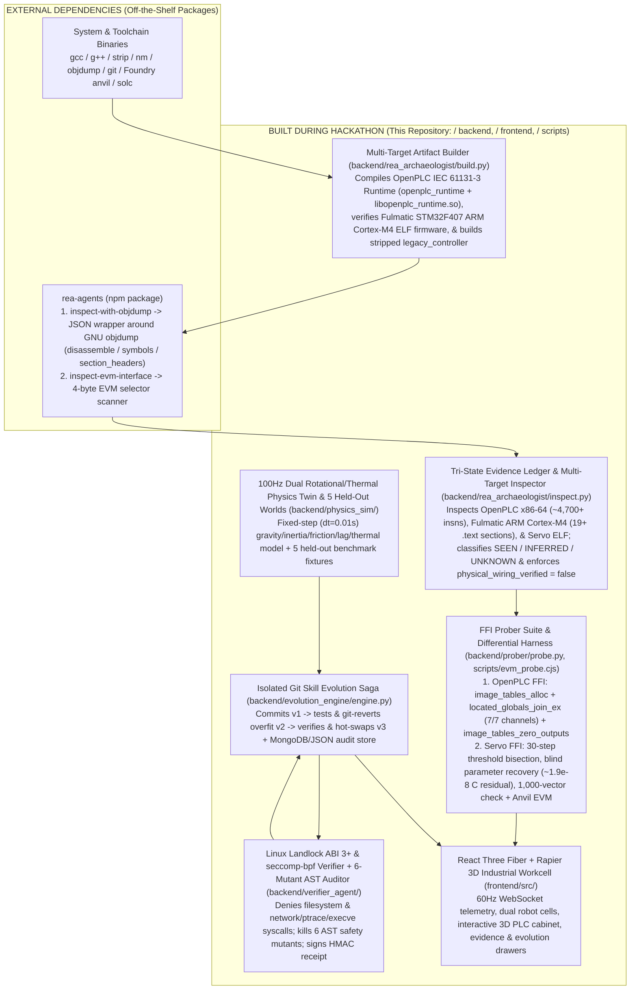

# LAZARUS-TWIN

**LAZARUS-TWIN is an industrial PLC reverse-engineering and safety-gated skill-evolution research workbench.** It inspects and probes two real open-source industrial PLC binaries — the **OpenPLC v4 IEC 61131-3 Runtime** (`elf64-x86-64` + `libopenplc_runtime.so`) and **Fulmatic STM32F407 ARM Cortex-M4 PLC Firmware** (`elf32-littlearm`, EABI5) — alongside an authored **Stripped Closed-Loop Servo Plant** (`legacy_controller`) and EVM governor bytecode (`legacy_governor.hex`), pairing a tri-state evidence ledger (`SEEN` / `INFERRED` / `UNKNOWN`), blind FFI bisection parameter recovery, a Linux Landlock + `seccomp-bpf` verification sandbox, an isolated Git commit/revert/hot-swap compensating saga, and a 60 FPS WebSocket-driven 3D dual-arm workcell.

### Technical Honesty & Scope Up Front

1. **Multi-Target Industrial Corpus (2 Real Open-Source PLC Targets + 1 Authored Servo Plant)**:
   - **Real Industrial Target 1 — OpenPLC v4 IEC 61131-3 Runtime** (`targets/openplc_runtime/` → `build/openplc_runtime` & `build/libopenplc_runtime.so`): Real open-source IEC 61131-3 PLC runtime (~172 KB `elf64-x86-64`, ~4,700+ disassembled instructions via `rea-agents` `gnu.objdump`) probed live via Python `ctypes` FFI (`image_tables_alloc`, `located_globals_join_ex` 7/7 channel binding, and `image_tables_zero_outputs` E-stop de-energization).
   - **Real Industrial Target 2 — Fulmatic STM32F407 ARM Cortex-M4 PLC Firmware** (`targets/fulmatic_cortex_m4/fulmatic_motion_cortex_m4.elf` & `fulmatic_core_cortex_m4.elf`): Real commercial DIN-rail STM32F407 ARM Cortex-M4 (`elf32-littlearm`, EABI5) PLC firmware from `FultekPLC/Plc-Firmware`, inspected via `rea-agents` (`gnu.objdump` `symbols` & `section_headers`).
   - **Authored Closed-Loop Servo Plant — `targets/legacy_controller.c` (22 lines) & `contracts/legacy_governor.hex`**: Authored demonstration plant compiled (`gcc -O2 -fno-ident`) and stripped (`strip --strip-all`) locally to drive the closed-loop 30-step FFI bisection parameter recovery, 100 Hz dual-arm physics twin, and 6-stage evolutionary verification gate.
2. **Sampled Self-Consistency + Blind FFI Bisection, Not Formal Proof**:
   - The 1,000-vector equivalence check compares the stripped CLI executable (`build/legacy_controller`), shared library (`build/legacy_controller.so`), and authored Python baseline (`templates/v1.py`) across 9 boundary edge cases (including `NaN` and `±Inf`) plus 991 seeded pseudo-random vectors (`seed=2026`). This is **sampled differential testing**, not a formal verification proof.
   - In addition, the prober performs **blind FFI 30-step binary bisection** and finite-difference probing against `build/legacy_controller.so` without reading source or templates. Because 30-step bisection on `[0, 120]` resolves thresholds to `120 / 2^30 ≈ 1.12e-7°C`, evaluating the blind-recovered controller at the exact `88.0°C` boundary exposes a real **`~1.9e-8°C` floating-point midpoint residual** (`88.0°C ± 1.86e-8°C`), demonstrating why finite-sample black-box probing is never a formal proof.
3. **Proposed Demo PLC Topology (`physical_wiring_verified: false`)**:
   - PLC terminal mappings (`%IW0`–`%QX0.1`) carry `provenance: "proposed_demo_topology"` and `physical_wiring_verified: false`.
   - Active FFI sweeps exercise software argument channels (`target`, `velocity`, `temp`), promoting their mapped terminals from `UNKNOWN`/`INFERRED` to `SEEN`. Because joint angle (`%IW1`, `angle`) is held constant at `0.0°` during boundary sweeps, `%IW1` remains `INFERRED` (`6/7` terminals `SEEN`), and `physical_wiring_verified` remains `false`. Physical fieldbus or screw-terminal continuity is never claimed.
4. **Template vs Synthesized Evolution Transparency**:
   - `v1.py` (recovered PD baseline) and `v2.py` (aggressive high-gain candidate that passes training but fails held-out World 3) are authored repository templates.
   - For `v3`, the engine queries Meta (`muse-spark-1.3`) when configured and online (`MUSE_SYNTHESIZED`), or falls back deterministically to `templates/v3.py` (`LOCAL_TEMPLATE`) when offline or if an LLM proposal fails sandbox verification. Both origins are explicitly badged in the UI and API response.

---

## 60-Second Demo Video

> **Video Placeholder**: `[Insert 60-Second Walkthrough Video Link / Embed Here]`
>
> | Timestamp | Highlight | What Judges See |
> | :--- | :--- | :--- |
> | **`0:00–0:20`** | **Dual-Arm Workcell & Fault Injection** | Daylight 3D factory workcell comparing **Cell 01 (Stripped C Binary)** vs **Cell 02 (Sandboxed Python Twin)** against the `30.0°` target reticle. Injecting `-58%` motor torque loss causes both arms to sag to `~16.6°` (`13.4°` tracking error), or injecting an `89.5°C` thermal spike trips the mechanical E-stop latch and cooling solenoid. |
> | **`0:20–0:40`** | **Multi-Target PLC Archaeology & Blind FFI Bisection** | Clicking **Probe I/O Branches** runs `rea-agents` static inspection across the **OpenPLC IEC 61131-3 Runtime** (~4,700+ instructions + live FFI `%IX`/`%QX`/`%IW`/`%QW` binding & E-stop zeroing), **Fulmatic STM32F407 ARM Cortex-M4 PLC Firmware** (`elf32-littlearm`), and **Stripped Servo Plant** (30-step FFI bisection + local Anvil EVM trace). PLC cabinet wires transition `UNKNOWN → INFERRED → SEEN` while `%IW1` stays `INFERRED` and `physical_wiring_verified` remains `false`. |
> | **`0:40–1:00`** | **Held-Out World Rejection, `git revert`, & Landlock Hot-Swap** | Clicking **Evolve Skill** commits `v2` (`kp=18.0`), which **passes training** (`0.78°` error) but **fails held-out World 3** (`High inertia + sensor lag`, `30.0°` overshoot + E-stop), triggering an automatic `git revert`. Candidate `v3` (`LOCAL_TEMPLATE` or `MUSE_SYNTHESIZED`) passes all 5 held-out worlds and kills `6/6` AST mutants inside the Linux Landlock ABI 3+ / `seccomp-bpf` sandbox, hot-swapping into Cell 02 to restore the `30.0°` target while Cell 01 remains drooped. |

---

## 3-Minute Live Judge Demo Talk Track (`0:00–3:00`)

`./scripts/start_demo.sh` automatically resets `.skills/controllers/active_skill.py` to `v1` and pre-warms all three industrial targets (`openplc_runtime`, `fulmatic_motion_cortex_m4.elf`, and `legacy_controller`) into `build/prewarmed_probe.json` on boot so live probing responds in `<150ms` (with a toggleable cold-run option) and never eats 40 seconds of the judging slot.

### `0:00–0:40` — 1. Living Factory & Dual-Arm Baseline
- **Action**: Open <http://localhost:5173>. Orbit the 3D twin-cell workcell.
- **What to Point Out**:
  - **Cell 01 (`LEFT_LEGACY`)** runs the compiled, symbol-stripped C binary (`build/legacy_controller.so` via `ctypes` FFI).
  - **Cell 02 (`RIGHT_EVOLVED`)** runs the active Python skill (`v1`) inside an OS-restricted subprocess worker.
  - Point out the top telemetry badges: `SIM TWIN` (honest 100 Hz fixed-step rotational/thermal physics), `WS TELEMETRY`, and `physical_wiring_verified: false`. Both arms track the `30.0°` green target reticle under nominal conditions.

### `0:40–1:10` — 2. Fault Injection Only (No Forced Evolve)
- **Action**: Click **Inject Load Fault (`-58%` Torque)** *(or **Thermal Spike (`89.5°C`)**)* in the header without triggering evolution.
- **What to Point Out**:
  - Under `-58%` torque loss + `25.0` gravity load, both the stripped C binary (Cell 01) and the `v1` PD twin (Cell 02) sag mechanically to **`~16.6°`** (`~13.4°` steady-state tracking error) because the legacy PD controller (`3.0 * error - 0.8 * velocity`) lacks integral action and gravity feedforward.
  - Under **Thermal Spike (`89.5°C`)**, both arms immediately latch `estop=1`, drop PWM to `0.0%`, and activate the cooling solenoid (`cooling=1`). Click **Reset Plant** to clear the latched E-stop before continuing.

### `1:10–2:10` — 3. Probe Unknown Branches (OpenPLC + Fulmatic ARM Cortex-M4 + Servo Bisection)
- **Action**: Click **Probe I/O Branches**.
- **What to Point Out**:
  - **Real Open-Source Industrial PLC Targets**: Show that the archaeology pipeline inspects and probes two real industrial PLC targets alongside the closed-loop servo plant:
    1. **OpenPLC v4 IEC 61131-3 Runtime (`build/openplc_runtime` & `libopenplc_runtime.so`)**: ~4,700+ `elf64-x86-64` instructions disassembled via `rea-agents` (`image_tables_bind_located_vars`, `image_tables_zero_outputs`, `_Z16plc_cycle_threadPv`) + live `ctypes` FFI probing that allocates `%IX`/`%QX`/`%IW`/`%QW` tables, binds 7/7 IEC 61131-3 channels via `located_globals_join_ex`, and verifies emergency-stop output de-energization via `image_tables_zero_outputs()`.
    2. **Fulmatic STM32F407 ARM Cortex-M4 PLC Firmware (`fulmatic_motion_cortex_m4.elf`)**: Real `elf32-littlearm` (EABI5) DIN-rail PLC firmware inspected via `rea-agents`, extracting `.text.MotionControl`, `.text.SetPosition`, `.text.SetVelocity`, `.text.GotoStop`, `.text.FulmaticExecute`, `.text._WatchDog`, and hardware PTO/timer ABI symbols (`_MotionSetPTO`, `_GetMsTimerCount`).
  - **Honest Pin Provenance**: In the 3D PLC cabinet and topology table, `%IW0`, `%IW2`, `%IW3`, `%QW0`, `%QX0.0`, and `%QX0.1` promote to `SEEN`, while **`%IW1` (Joint angle) stays `INFERRED`** because `angle` was held at `0.0°` during boundary sweeps. Therefore `physical_wiring_verified` remains **`false`**.
  - **Blind Bisection Recovery vs Sealed Ground Truth**: Point to the recovered servo parameters (`cooling = 72.0°C`, `thermal = 88.0°C`, `runaway = ±45.0°`, `kp = 3.0`, `kd = -0.8`) alongside the real `~1.9e-8°C` floating-point bisection residual at `t = 88.0°C` (`88.0°C ± 1.86e-8°C`).

### `2:10–2:50` — 4. Sandboxed Git Evolution (`v1 → v2 Reject/Revert → v3 Adopt`)
- **Action**: With Load Fault active, click **Evolve Skill**.
- **What to Point Out**:
  - **Why Held-Out Worlds Matter (`v2` Rejection)**: Candidate `v2` (`kp = 18.0`, `kd = 0.5`) **PASSES the live training benchmark** (`0.78°` steady-state error, `0.0°` overshoot), which would fool a naive optimizer. However, the isolated verifier tests `v2` across **5 held-out perturbation worlds**; in **World 3 (`High inertia + sensor lag`: `inertia=4.5`, `sensor_lag=0.45s`)**, `v2` violently overshoots by **`30.0°`** and trips the runaway E-stop (`>45.0°` error).
  - **Real Compensating Git Revert**: The engine executes a real `git revert --no-edit` in the isolated skill repository and records `REJECTED_TRIGGER_GIT_REVERT`.
  - **Verified `v3` Promotion**: Candidate `v3` (clamped anti-windup integral + `0.15/0.85` velocity low-pass filter + `30.0 * cos(angle)` gravity feedforward, clearly badged as `LOCAL_TEMPLATE` or `MUSE_SYNTHESIZED`) passes **all 5 held-out worlds** (`<0.2°` steady-state error, `0.0°` overshoot) and **kills `6/6` AST safety mutants** inside the Linux **Landlock ABI 3+ (`filesystem: denied`) + `seccomp-bpf` (`network: seccomp-denied`)** sandbox.
  - **Live 3D Divergence**: Cell 02 hot-swaps to `v3` and climbs back to the **`30.0°` target reticle**, while Cell 01 (legacy C binary) remains drooped at `~16.6°`.

### `2:50–3:00` — 5. State Aloud: Built-vs-REA Boundary
- **Say Aloud to Judges**:
  > *"External `rea-agents` only wraps `objdump` into JSON for our three ELF targets — the real OpenPLC v4 IEC 61131-3 Runtime, the Fulmatic STM32F407 ARM Cortex-M4 PLC firmware, and our stripped servo plant — and extracts 4-byte selectors from the EVM hex. Everything else you just saw — the tri-state `SEEN`/`INFERRED`/`UNKNOWN` evidence ledger, the live OpenPLC `libopenplc_runtime.so` FFI image-table prober, the 30-step FFI binary bisection prober, the 1,000-vector CLI/FFI/Python and 262-vector Anvil differential harnesses, the 100Hz rotational/thermal physics engine with 5 held-out worlds, the Linux Landlock + seccomp-bpf sandbox and 6-mutant AST auditor, the Git commit/revert compensating saga, and the 3D workcell — was built from scratch in this repository during the hackathon."*

---

## Architecture: Built During Hackathon vs External (`rea-agents`)



### Component Ownership Breakdown

| Subsystem | Classification | Exact Responsibility & Boundary |
| :--- | :--- | :--- |
| **`rea-agents` npm CLI** (`node_modules/rea-agents`) | **External Dependency** | Invokes GNU `objdump` on `build/openplc_runtime`, `targets/fulmatic_cortex_m4/*.elf`, and `build/legacy_controller`, wrapping raw stdout with a SHA-256 subject digest (`build/rea_evidence.json`); scans `contracts/legacy_governor.hex` for 4-byte EVM function selectors (`build/rea_evm_evidence.json`). **Does not** infer control laws, probe FFI memory tables, bisect thresholds, or map PLC pins. |
| **GNU `gcc` / `g++` / `strip` / `objdump` & Foundry `anvil`** | **External Toolchain** | Compiles/strips the C/C++ targets, inspects x86-64 and `elf32-littlearm` binaries, and provides a local ephemeral EVM JSON-RPC node for bytecode execution and `debug_traceCall`. |
| **Multi-Target Evidence Ledger & Topology Mapper** (`backend/rea_archaeologist/inspect.py`) | **Built During Hackathon** | Orchestrates `rea-agents` across OpenPLC, Fulmatic ARM Cortex-M4, and the stripped servo plant; parses `xmm`/`sd` floating-point ops, conditional jumps, IEC 61131-3 image-table symbols, and ARM `.text` motion sections; initializes the `SEEN` / `INFERRED` / `UNKNOWN` evidence graph while enforcing `physical_wiring_verified: false`. |
| **OpenPLC IEC 61131-3 FFI Prober & Blind Servo Bisection Prober** (`backend/prober/probe.py`, `ffi.py`) | **Built During Hackathon** | Probes `build/libopenplc_runtime.so` via `ctypes` FFI (`image_tables_alloc`, `located_globals_join_ex`, `image_tables_zero_outputs`) and probes `build/legacy_controller.so` via 30-step binary bisection (`72.0°C`, `88.0°C`, `±45.0°`, `kp=3.0`, `kd=-0.8`), exposing the `~1.9e-8°C` boundary residual across 1,000 CLI/FFI/Python vectors. |
| **Anvil Differential EVM Harness** (`scripts/evm_probe.cjs`, `contracts/`) | **Built During Hackathon** | Installs `contracts/legacy_governor.hex` at `0x...beef` on local Anvil, deploys `RecoveredGovernor.sol`, compares 262 integer-scaled vectors across both contracts, and captures `build/evm_trace.json`. |
| **100 Hz Physics Engine & 5 Held-Out Worlds** (`backend/physics_sim/`) | **Built During Hackathon** | Simulates dual rotational arms (`dt = 0.01s`) with gravity load, motor efficiency loss, viscous friction, ring-buffer sensor lag, and core thermal dynamics across the live workcell and 5 held-out benchmark worlds (`Payload mass`, `Low friction`, `High inertia + sensor lag`, `Thermal stress`, `Combined perturbations`). |
| **Landlock + `seccomp-bpf` Sandbox & AST Mutation Auditor** (`backend/verifier_agent/`) | **Built During Hackathon** | Enforces Linux Landlock ABI 3+ (`handled_access_fs` bits `0..14` denied, verified via `/etc/passwd` self-test) and `libseccomp` syscall filtering (`socket`, `connect`, `ptrace`, `execve`, etc. blocked with `EPERM`) in both candidate workers and the black-box verifier; generates and kills 6 AST safety mutants (`thermal`, `cooling`, `runaway`, `saturation`, `invalid_inputs`, `direction`). |
| **Isolated Git Evolution Saga & Multi-Agent Bus** (`backend/evolution_engine/`, `backend/agents/`) | **Built During Hackathon** | Coordinates local Fetch.ai `uAgents` (`archaeologist`, `architect`, `verifier`), runs the `v1 → v2 (git revert) → v3 (hot-swap)` compensating workflow in an isolated Git repo (`.data/skill_repositories/<uuid>`), and persists telemetry/verdicts to MongoDB Atlas or local `.data/local_store.json`. |
| **3D Industrial Workcell & Operator Console** (`frontend/src/`) | **Built During Hackathon** | React Three Fiber + Rapier kinematic 3D workcell with twin robot cells, clickable PLC cabinet wiring (`SEEN`/`INFERRED`/`UNKNOWN`), live telemetry strip, and modal drawers for REA evidence and Git evolution history. |

---

## Real Open-Source Industrial PLC Targets (Live Disassembly & FFI Probing)

To ensure the archaeology and probing pipeline is exercised against real-world industrial PLC architectures — not only a synthetic demo loop — LAZARUS-TWIN compiles, disassembles, and probes three distinct industrial targets under `targets/`:

### Target 1: OpenPLC v4 IEC 61131-3 Runtime (`targets/openplc_runtime/` → `build/openplc_runtime` & `build/libopenplc_runtime.so`)
- **Binary Artifact**: Compiled natively from the open-source OpenPLC runtime (`targets/openplc_runtime/`) into a ~172 KB `elf64-x86-64` executable (`build/openplc_runtime`, ~4,700+ disassembled instructions) and shared library (`build/libopenplc_runtime.so`).
- **Live `rea-agents` (`gnu.objdump`) Disassembly**: Extracts real IEC 61131-3 PLC scan-cycle and memory-image management routines, including:
  - `image_tables_bind_located_vars`
  - `image_tables_zero_outputs`
  - `image_tables_alloc`
  - `located_globals_join_ex`
  - `_Z16plc_cycle_threadPv`
- **Live Python `ctypes` FFI Probing (`libopenplc_runtime.so`)**:
  - Calls `image_tables_alloc()` to initialize the IEC 61131-3 `%IX` (discrete input), `%QX` (discrete output), `%IW` (analog input word), and `%QW` (analog output word) memory image tables.
  - Binds all **7/7 PLC located globals** (`%IW0`–`%IW3`, `%QW0`, `%QX0.0`, `%QX0.1`) via `located_globals_join_ex()`.
  - Verifies hardware fail-safe de-energization by writing active actuator states into `%QW0` / `%QX0.0` / `%QX0.1`, invoking `image_tables_zero_outputs()`, and asserting all output channels deterministically zero on emergency stop.

### Target 2: Fulmatic STM32F407 ARM Cortex-M4 PLC Firmware (`targets/fulmatic_cortex_m4/fulmatic_motion_cortex_m4.elf` & `fulmatic_core_cortex_m4.elf`)
- **Binary Artifact**: Real commercial DIN-rail STM32F407 ARM Cortex-M4 (`elf32-littlearm`, `Machine: ARM`, EABI5) industrial PLC firmware binaries from `FultekPLC/Plc-Firmware`.
- **Live `rea-agents` (`gnu.objdump` `symbols` & `section_headers`) Inspection**:
  - Extracts **19+ ARM Thumb `.text` PLC motion and scan-execution sections**, including `.text.MotionControl`, `.text.SetPosition`, `.text.SetVelocity`, `.text.CheckVelocity`, `.text.GotoStop`, `.text.FulmaticExecute`, and `.text._WatchDog`.
  - Recovers low-level hardware PTO (Pulse Train Output), timer, and variable-resolution ABI symbols (`_MotionSetPTO`, `_GetMsTimerCount`, `BitVariableResolve`, `GetFloat`, `SetBit`).

### Target 3: Stripped Closed-Loop Servo Plant (`targets/legacy_controller.c` → `build/legacy_controller` & `build/legacy_controller.so`)
- **Binary Artifact**: Stripped `elf64-x86-64` closed-loop PD + thermal/runaway interlock controller (`nm build/legacy_controller` → `no symbols`).
- **Role in the Workbench**: Drives the closed-loop **30-step FFI binary bisection parameter recovery** (`72.0°C` cooling, `88.0°C ± 1.86e-8°C` thermal trip, `±45.0°` runaway interlock, `kp=3.0`, `kd=-0.8`), the 1,000-vector CLI/FFI/Python equivalence check, the 100 Hz dual-arm 3D physics workcell, and the 6-stage Landlock/`seccomp-bpf` evolutionary verification gate.

---

## Run the Demo

On Linux (kernel 5.13+ with Landlock ABI 3+ and `libseccomp`), ensure Python 3 with `venv`, Node/npm, Git, GCC/G++, `strip`, `nm`, and GNU `objdump` are installed, then run:

```bash
./scripts/start_demo.sh
```

What `./scripts/start_demo.sh` does:
1. Runs `./scripts/setup.sh` to create `.venv` and install missing Python and Node dependencies (including local Node 22 and `rea-agents`).
2. Verifies ports `8010` (FastAPI backend) and `5173` (Vite frontend) are free.
3. Resets `.skills/controllers/active_skill.py` to `backend/evolution_engine/templates/v1.py` so every demo session starts cleanly at the `v1` baseline.
4. Compiles, inspects via REA `objdump`, and pre-warms all 3 industrial targets (`build/openplc_runtime` & `build/libopenplc_runtime.so`, `targets/fulmatic_cortex_m4/fulmatic_motion_cortex_m4.elf`, and `build/legacy_controller` & `build/legacy_controller.so`) plus `build/rea_evidence.json`, `build/rea_evm_evidence.json`, `build/evm_trace.json`, and `build/prewarmed_probe.json`.
5. Starts both services and prints the **3-Minute Judge Demo Runbook** to the terminal. Open <http://localhost:5173> (API on <http://localhost:8010>). Press `Ctrl-C` to stop both cleanly.

---

## Configure Integrations (Optional `.env`)

Place optional credentials in an untracked `.env` in the repository root (never commit `.env`):

```dotenv
# Optional MongoDB Atlas connection (falls back to local .data/local_store.json when omitted or unreachable)
MONGODB_URI=
MONGODB_CONNECT=
MONGODB_USER=
MONGODB_PASS=

# Optional LLM / decision providers
META_API_KEY=
META_MODEL=muse-spark-1.3
SUBQUADRATIC_API_KEY=

# Optional: force deterministic offline fallbacks for Meta/SubQ (does not disable MongoDB)
LAZARUS_OFFLINE=1
```

- **MongoDB vs Local Store**: With a reachable MongoDB deployment, the workbench uses `lazarus_twin_db` (time-series collection, `$graphLookup`, vector search index `skill_memory_vector`, change streams, and multi-document transactions). Without `MONGODB_URI`, it runs deterministically against `.data/local_store.json` and clearly reports `local_json` mode.
- **Meta & Subquadratic**: When `META_API_KEY` and `SUBQUADRATIC_API_KEY` are configured and `LAZARUS_OFFLINE` is not set, active probing sends disassembly/probe evidence to SubQ Snap and Meta, and `Evolve Skill` requests a synthesized `v3` candidate from Meta (`MUSE_SYNTHESIZED`) before falling back to `templates/v3.py` (`LOCAL_TEMPLATE`) if offline or rejected by the verifier.

---

## Verify All Claims

Run the full end-to-end verification suite at any time:

```bash
./scripts/verify_all.sh
```

This executes:
1. **`pytest -q tests backend/llm_router/test_router.py`** — Compiles and inspects the OpenPLC IEC 61131-3 Runtime, Fulmatic STM32F407 ARM Cortex-M4 ELF firmware, and stripped `legacy_controller`, runs `rea-agents` + GNU `objdump`, executes live OpenPLC `ctypes` FFI table probes and 30-step servo boundary bisection + 1,000-vector CLI/FFI/Python equivalence checks, verifies all 6 AST mutants are killed inside the Landlock + `seccomp-bpf` sandbox, exercises the `v1 → v2 (git revert) → v3 (adopt)` evolution saga across all 5 held-out worlds, and tests the REST/WebSocket API.
2. **`nm build/legacy_controller`** — Verifies the closed-loop target ELF binary has no static symbol table (`no symbols`).
3. **`./node_modules/node/bin/node scripts/evm_probe.cjs`** — Spawns a local Anvil instance, deploys `contracts/legacy_governor.hex` and `contracts/RecoveredGovernor.sol`, and verifies 262 differential vectors plus opcode trace capture.
4. **`npm --prefix frontend run build`** — Type-checks (`tsc -b`) and builds the production frontend bundle.

### Live API Endpoints

- `GET /api/health` — Active skill version (`v1` or `v3`), Git commit hash, storage/provider status, and telemetry queue health.
- `POST /api/archaeology/inspect` — Pass `{"run_active_probes": true}` (or `"judge_mode": true` to use pre-warmed `build/prewarmed_probe.json`) for multi-target REA static inspection (OpenPLC x86-64, Fulmatic ARM Cortex-M4, and Servo ELF), OpenPLC & Servo FFI sweeps, blind parameter recovery, 1,000-vector check, and Anvil EVM trace.
- `POST /api/sabotage` — Pass `{"enabled": true|false, "thermal_spike": true|false, "auto_evolve": false}` to inject load fault, thermal spike, or reset the plant.
- `POST /api/evolve` — Execute the `v1 → v2 (reject/revert) → v3 (adopt)` Git evolution saga.
- `POST /api/verify` — Run the isolated 6-mutant AST safety audit on the active controller.
- `GET /api/mongodb/stats` — Storage mode (`atlas` or `local_json`) and collection document counters.
- `WS /ws` — 60 Hz dual-twin telemetry and verification bus events.
