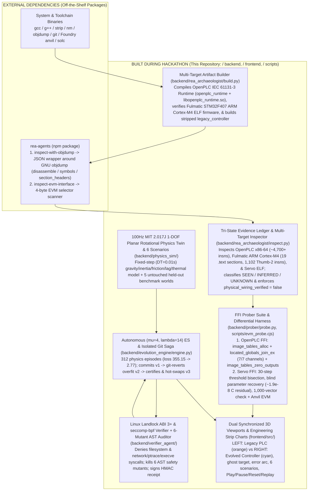

# LAZARUS-TWIN

**LAZARUS-TWIN is an industrial PLC reverse-engineering and safety-gated skill-evolution research workbench.** It inspects and probes two real open-source industrial PLC binaries — the **OpenPLC v4 IEC 61131-3 Runtime** (`elf64-x86-64` + `libopenplc_runtime.so`) and **Fulmatic STM32F407 ARM Cortex-M4 PLC Firmware** (`elf32-littlearm`, EABI5) — alongside an authored **Stripped Closed-Loop Servo Plant** (`legacy_controller`) and EVM governor bytecode (`legacy_governor.hex`), pairing a tri-state evidence ledger (`SEEN` / `INFERRED` / `UNKNOWN`), blind FFI bisection parameter recovery, an autonomous **`(µ=4, λ=14)` Evolutionary Strategy (`312` Closed-Loop Physics Episodes)**, a Linux Landlock + `seccomp-bpf` verification sandbox, an isolated Git commit/revert/hot-swap compensating saga, and **Two Synchronized 3D Viewports (`LEFT: Legacy PLC Controller`, `RIGHT: Autonomously Evolved Controller`)** paired with **Synchronized Time-Series Engineering Graphs**.

### Technical Honesty & Scope Up Front

1. **Multi-Target Industrial Corpus (2 Real Open-Source PLC Targets + 1 Authored Servo Plant)**:
   - **Real Industrial Target 1 — OpenPLC v4 IEC 61131-3 Runtime** (`targets/openplc_runtime/` → `build/openplc_runtime` & `build/libopenplc_runtime.so`): Real open-source IEC 61131-3 PLC runtime (~172 KB `elf64-x86-64`, ~4,700+ disassembled instructions via `rea-agents` `gnu.objdump`) probed live via Python `ctypes` FFI (`image_tables_alloc`, `located_globals_join_ex` 7/7 channel binding, and `image_tables_zero_outputs` E-stop de-energization) plus closed-loop physics bench validation across all 5 held-out worlds.
   - **Real Industrial Target 2 — Fulmatic STM32F407 ARM Cortex-M4 PLC Firmware** (`targets/fulmatic_cortex_m4/fulmatic_motion_cortex_m4.elf` & `fulmatic_core_cortex_m4.elf`): Real commercial DIN-rail STM32F407 ARM Cortex-M4 (`elf32-littlearm`, EABI5) PLC firmware from `FultekPLC/Plc-Firmware`, inspected via `rea-agents` (`gnu.objdump` `symbols`, `section_headers`, and `1,102` decoded Thumb-2 instructions across `19` `.text` motion sections) and evaluated in closed-loop physics simulation across all 5 held-out worlds.
   - **Authored Closed-Loop Servo Plant — `targets/legacy_controller.c` (22 lines) & `contracts/legacy_governor.hex`**: Authored demonstration plant compiled (`gcc -O2 -fno-ident`) and stripped (`strip --strip-all`) locally to drive the closed-loop 30-step FFI bisection parameter recovery, 100 Hz dual-arm physics twin, and 6-stage evolutionary verification gate.
2. **Sampled Self-Consistency + Blind FFI Bisection, Not Formal Proof**:
   - The 1,000-vector equivalence check compares the stripped CLI executable (`build/legacy_controller`), shared library (`build/legacy_controller.so`), and authored Python baseline (`templates/v1.py`) across 9 boundary edge cases (including `NaN` and `±Inf`) plus 991 seeded pseudo-random vectors (`seed=2026`). This is **sampled differential testing**, not a formal verification proof.
   - In addition, the prober performs **blind FFI 30-step binary bisection** and finite-difference probing against `build/legacy_controller.so` without reading source or templates. Because 30-step bisection on `[0, 120]` resolves thresholds to `120 / 2^30 ≈ 1.12e-7°C`, evaluating the blind-recovered controller at the exact `88.0°C` boundary exposes a real **`~1.9e-8°C` floating-point midpoint residual** (`88.0°C ± 1.86e-8°C`), demonstrating why finite-sample black-box probing is never a formal proof.
3. **Proposed Demo PLC Topology (`physical_wiring_verified: false`)**:
   - PLC terminal mappings (`%IW0`–`%QX0.1`) carry `provenance: "proposed_demo_topology"` and `physical_wiring_verified: false`.
   - Active FFI sweeps exercise software argument channels (`target`, `velocity`, `temp`), promoting their mapped terminals from `UNKNOWN`/`INFERRED` to `SEEN`. Because joint angle (`%IW1`, `angle`) is held constant at `0.0°` during boundary sweeps, `%IW1` remains `INFERRED` (`6/7` terminals `SEEN`), and `physical_wiring_verified` remains `false`. Physical fieldbus or screw-terminal continuity is never claimed.
4. **Autonomous `(µ=4, λ=14)` Evolutionary Strategy vs Optional LLM Synthesis Transparency**:
   - `v1.py` is the FFI-probed PD baseline (`kp=3.0, kd=0.8, ki=0.0, k_ff=0.0, alpha_v=1.0, i_clamp=10.0`).
   - `v2` (`SINGLE_WORLD_ES_OVERFIT`, `kp=17.196, kd=0.585`) is generated by a single-world ES stage that optimizes only on the lag-free nominal workcell: it **passes training** (`0.819°` steady-state error, `0.0°` overshoot) but **fails held-out World 3** (`High inertia + sensor lag`, `30.0°` peak overshoot + runaway E-stop), triggering a real `git revert`.
   - `v3` (`AUTONOMOUS_ES_EVOLVED`) is evolved online from the FFI-probed `v1` baseline via a **7-generation `(µ=4, λ=14)` Evolutionary Strategy across `312` closed-loop physics episodes** on 3 domain-randomized training environments (without ever accessing the 5 held-out worlds in `backend/physics_sim/worlds.py`), converging to `kp=3.554, kd=10.608, ki=0.649, k_ff=32.931, alpha_v=0.817, i_clamp=41.68` (`-99.2%` training loss reduction: `355.15 → 2.77`) and passing **`5/5` untouched held-out worlds** + **`6/6` AST safety mutants**. When Meta (`muse-spark-1.3`) is explicitly configured online, `MUSE_SYNTHESIZED` proposals are also evaluated through the exact same gate, with `LOCAL_TEMPLATE` as a deterministic fallback. Every origin is explicitly badged in the UI and API response.

---

## 1-DOF Planar Rotational Physics Convention (`MIT 2.017J`) & Dual Synchronized 3D Viewports

The simulation engine (`Arm.step()` in `backend/physics_sim/engine.py`) implements a deterministic, fixed-step (`DT = 0.01s`, `100 Hz`) **1-DOF planar rotational servo mechanism** following the standard **`MIT 2.017J`** planar rotational dynamics convention:

```python
acceleration = (efficiency * pwm - gravity * math.cos(math.radians(angle)) - friction * velocity) / inertia
velocity += acceleration * DT
angle += velocity * DT
```

- **Coordinate & Angle Convention**:
  - Zero angle (`0°`) is horizontal (`+X` axis).
  - Rotation is counterclockwise about `+Z` in the vertical `X-Y` plane, so gravity exerts a restoring torque proportional to `gravity * cos(radians(angle))` that pulls the arm downward when horizontal (`cos(0°) = 1.0`).
  - The nominal target setpoint is **`+30.0°`**, with physical mechanical stops clamped at **`[-90.0°, +90.0°]`** so a tripped or de-energized arm rests against the lower stop rather than spinning indefinitely.
  - Core thermal dynamics integrate actuator heating and active cryo-cooling at each `100 Hz` step: `temperature += (abs(pwm) * 0.0005 - (0.025 if cooling else 0.0)) * DT`, with cooling relay activation at **`72.0°C`** and latched hardware emergency stop (`estop = 1`, `pwm = 0.0%`) at **`88.0°C`** or **`|target - angle| > 45.0°`**.
- **Two Synchronized 3D Viewports (`LEFT: Legacy PLC Controller`, `RIGHT: Autonomously Evolved Controller`)**:
  - **Viewport 1 (`LEFT: Legacy PLC Controller`)**: Driven directly by the compiled, symbol-stripped C binary (`build/legacy_controller.so` via `ctypes` FFI). Renders a fixed industrial base pedestal and a single rigid rotating arm in **industrial orange**.
  - **Viewport 2 (`RIGHT: Autonomously Evolved Controller`)**: Driven by the active Python controller skill (`v1` baseline or hot-swapped `v3` evolved skill) executing inside a Linux Landlock + `seccomp-bpf` restricted worker subprocess. Renders an identical fixed industrial base and a single rigid rotating arm in **cyan**.
  - **Translucent Green Ghost Arm (`+30.0°` Setpoint)**: Both viewports render a translucent green reference ghost arm locked at the `+30.0°` target angle for immediate visual comparison.
  - **Dynamic Angular Error Arc**: A live angular sector arc spans between the arm's instantaneous angle `θ(t)` and the `+30.0°` target reticle, expanding in amber/red when tracking error grows or sagging occurs.
  - **Endpoint Payload Mass**: When additional gravity/payload load is active (`sabotage_active: true` or perturbed scenarios), a visible endpoint payload mass is attached to the tip of the rotating arm.

---

## 6 Backend Scenarios, Transport Controls, & Synchronized Time-Series Engineering Graphs

### 6 Deterministic Backend Scenarios (`GET /api/scenarios` & `POST /api/sim/control`)

Operators and judges can switch live between **6 backend physics scenarios** defined in `backend/physics_sim/engine.py` and `backend/physics_sim/worlds.py`:

| Scenario ID (`scenario_id`) | UI Scenario Label | Motor Efficiency | Gravity Load | Rotational Inertia | Viscous Friction | Sensor Lag (`s`) | Initial Temp (`°C`) | Physical Behavior Highlight |
| :--- | :--- | :---: | :---: | :---: | :---: | :---: | :---: | :--- |
| **`nominal`** | **Nominal** | `1.00` | `8.0` | `2.0` | `1.2` | `0.00s` | `30.0°C` | Baseline unperturbed workcell; both `LEFT` (`legacy`) and `RIGHT` (`v1`/`v3`) track near `30.0°`. |
| **`payload_mass`** | **Heavy payload** (`Payload mass`) | `0.40` | `26.0` | `2.4` | `1.2` | `0.00s` | `30.0°C` | `-60%` motor torque efficiency + `26.0` gravity load; legacy PD arm droops to **`~16.6°`** (`~13.4°` error), while evolved `v3` holds **`30.0°`**. |
| **`low_friction`** | **Low friction** | `0.45` | `24.0` | `1.7` | `0.3` | `0.00s` | `30.0°C` | Underdamped joint (`friction = 0.3`); exposes oscillatory ringing in poorly damped controllers while `v3` (`kd = 10.608`) damps cleanly. |
| **`high_inertia_sensor_lag`** | **High inertia and sensor lag** | `0.42` | `25.0` | `4.5` | `0.6` | `0.45s` | `30.0°C` | **Held-Out World 3 killer**: `450ms` ring-buffer feedback delay + `4.5` inertia causes overfit `v2` (`kp = 17.196`) to overshoot by `30.0°` and trip E-stop, whereas `v3` settles smoothly with `0.0°` overshoot. |
| **`thermal_stress`** | **Thermal stress** | `0.46` | `22.0` | `2.2` | `1.0` | `0.00s` | `80.0°C` | Starts at `80.0°C` above the `72.0°C` cryo-cooling threshold (`cooling = 1`), testing thermal management below the `88.0°C` E-stop trip. |
| **`combined_perturbations`** | **Combined perturbations** | `0.38` | `26.0` | `3.0` | `1.1` | `0.18s` | `30.0°C` | Simultaneous `-62%` torque loss, heavy `26.0` payload, elevated `3.0` inertia, and `180ms` sensor lag. |

### Transport Controls (`Play / Pause / Reset / Replay`)

The simulation header provides deterministic transport controls wired to `POST /api/sim/control`:
- **Play (`action: "play"`)**: Resumes the `100 Hz` physics loop and `60 Hz` WebSocket telemetry stream from the current state.
- **Pause (`action: "pause"`)**: Freezes both arms at the exact simulation tick (`tick`) so judges can inspect instantaneous tracking error, PWM effort, and time-series cursors.
- **Reset (`action: "reset"`)**: Resets both arms to `0.0°` in the **`Nominal`** scenario (`efficiency = 1.0`, `gravity = 8.0`), clears any latched emergency stop (`estop = 0`), and starts a fresh telemetry run.
- **Replay (`action: "replay"`)**: Re-initializes both arms from `θ(0) = 0.0°`, `ω(0) = 0.0°/s` inside the **currently selected scenario** so judges can watch the transient step response of `LEFT (Legacy)` vs `RIGHT (Evolved)` from `t = 0.00s`.

### Synchronized Time-Series Engineering Graphs

Below the dual 3D viewports, a synchronized multi-channel engineering strip chart plots `LEFT: Legacy PLC` (orange) against `RIGHT: Evolved Skill` (cyan) in real time across 6 physical channels:
1. **`Target Angle` (`30.0°`)** — Dashed green reference setpoint line.
2. **`Actual Angle` (`θ(t)`, `deg`)** — Instantaneous joint position showing legacy sag (`~16.6°`) vs evolved recovery (`30.0°`).
3. **`Absolute Tracking Error` (`|target - θ(t)|`, `deg`)** — Direct quantitative comparison of steady-state droop and transient overshoot.
4. **`Angular Velocity` (`ω(t)`, `deg/s`)** — Joint rate showing velocity damping (`alpha_v = 0.817` low-pass derivative filter in `v3`).
5. **`PWM %` (`[-100%, +100%]`)** — Actuator command effort showing gravity feedforward (`k_ff = 32.931`) and anti-windup saturation bounds.
6. **`Core Temperature` (`°C`)** — Actuator thermal trajectory relative to the `72.0°C` cooling threshold and `88.0°C` hardware E-stop cutoff.

---

## Autonomous `(µ=4, λ=14)` Evolutionary Strategy (`312` Closed-Loop Physics Episodes)

When **Evolve Skill** (`POST /api/evolve`) is triggered, `EvolutionEngine` (`backend/evolution_engine/engine.py`) executes a two-stage evolutionary workflow inside an isolated Git repository (`.data/skill_repositories/<uuid>`) without ever reading the 5 held-out worlds in `backend/physics_sim/worlds.py`:

1. **Stage 0 — FFI-Probed `v1` Baseline (`RECOVERED_BASELINE`)**:
   - Initialized strictly from the blind FFI-probed parameters of `build/legacy_controller.so`:
     - **`v1` Genome**: `kp = 3.0, kd = 0.8, ki = 0.0, k_ff = 0.0, alpha_v = 1.0, i_clamp = 10.0`
   - Under nominal conditions `v1` tracks cleanly, but under heavy payload / `-58%` torque loss it suffers a **`~13.4°` steady-state droop** (`~16.6°` actual angle vs `30.0°` target).
2. **Stage 1 — Single-World ES Overfit Candidate (`v2`, `SINGLE_WORLD_ES_OVERFIT`) → `git revert`**:
   - Optimizes high-gain PD parameters (`kp = 17.196, kd = 0.585`) solely on the lag-free nominal workcell (`16` candidate evaluations).
   - **Passes the training benchmark** (`0.819°` steady-state error, `0.0°` overshoot), demonstrating how naive single-environment optimization appears to succeed.
   - **Rejected by the Isolated Black-Box Verifier**: When evaluated across the **5 untouched held-out perturbation worlds**, `v2` fails **World 3 (`High inertia + sensor lag`: `inertia = 4.5`, `sensor_lag = 0.45s`)** with a **`30.0°` peak overshoot** and trips the runaway E-stop (`>45.0°` error).
   - **Compensating Rollback**: The engine executes a real `git revert --no-edit` and records `REJECTED_TRIGGER_GIT_REVERT`.
3. **Stage 2 — Domain-Randomized `(µ=4, λ=14)` Evolutionary Strategy (`v3`, `AUTONOMOUS_ES_EVOLVED`) → Certified Hot-Swap**:
   - Starting strictly from the FFI-probed `v1` genome `[3.0, 0.8, 0.0, 0.0, 1.0, 10.0]`, `autonomous_es_optimize()` runs **7 generations** with parent elite count **`µ = 4`** and offspring population **`λ = 14`** across **3 domain-randomized training environments** (`train_heavy_load`, `train_lag_inertia`, `train_low_friction`, `2,400` steps per episode = **`312` closed-loop physics episodes** total).
   - **Loss Reduction (`-99.2%`)**: Mean training loss drops from **`355.15`** (at `v1` initialization; Gen 1 best `8.686`) down to **`2.77`** (`2.768` in Gen 7):

| Stage / Generation | Genome (`kp`, `kd`, `ki`, `k_ff`, `alpha_v`, `i_clamp`) | Mean Training Loss | Held-Out Worlds (`5/5`) | AST Mutants Killed (`6/6`) | Git Saga Verdict |
| :--- | :--- | :---: | :---: | :---: | :--- |
| **`v1` (FFI Baseline)** | `kp=3.000, kd=0.800, ki=0.000, k_ff=0.000, alpha_v=1.000, i_clamp=10.00` | `355.15` | Fails under load (`13.4°` droop) | `6/6` | `BASELINE` |
| **`v2` (Single-World ES)** | `kp=17.196, kd=0.585, ki=0.000, k_ff=0.000, alpha_v=1.000, i_clamp=10.00` | Overfit (`0.819°` nominal err) | **FAIL (`3/5`)** — World 3 `30.0°` overshoot + E-stop | `6/6` | `REVERTED` (`git revert`) |
| **`v3` (`µ=4, λ=14` ES, 312 eps)** | **`kp=3.554, kd=10.608, ki=0.649, k_ff=32.931, alpha_v=0.817, i_clamp=41.68`** | **`2.77` (`-99.2%`)** | **PASS (`5/5` Untouched Worlds)** | **`6/6` (`100%`)** | **`ADOPTED` (`CERTIFIED_FOR_HOT_SWAP`)** |

---

## 5-Beat 3-Minute Live Demo Script (`0:00–3:00`)

`./scripts/start_demo.sh` automatically resets `.skills/controllers/active_skill.py` to `v1` and pre-warms all three industrial targets (`openplc_runtime`, `fulmatic_motion_cortex_m4.elf`, and `legacy_controller`) into `build/prewarmed_probe.json` on boot so live probing responds in `<150ms` (with a toggleable cold-run option).

### Beat 1 (`0:00–0:25`) — Dual Synchronized 3D Viewports & `MIT 2.017J` Planar Physics Baseline
- **Action**: Open <http://localhost:5173>. Point out the **Two Synchronized 3D Viewports** (`LEFT: Legacy PLC Controller` in orange vs `RIGHT: Autonomously Evolved Controller` in cyan) and the **Synchronized Time-Series Engineering Graphs** underneath.
- **What to Say**:
  - *"Both cells run our 100 Hz fixed-step `MIT 2.017J` 1-DOF planar rotational physics model (`acceleration = (efficiency * pwm - gravity * cos(angle) - friction * velocity) / inertia`), where `0°` is horizontal (`+X`) and both arms track the translucent green ghost arm at `+30.0°`. Left runs the symbol-stripped C binary via `ctypes` FFI; Right runs the active Python controller inside a Linux Landlock + `seccomp-bpf` sandbox."*

### Beat 2 (`0:25–1:10`) — 6 Backend Scenarios, Transport Bar, & Mechanical Sag Under Load
- **Action**: Select **`Heavy payload`** (`payload_mass`) or **`High inertia and sensor lag`** (`high_inertia_sensor_lag`) in the **6-Scenario Selector**, watch the dynamic angular error arc and endpoint payload mass appear, then demonstrate **`Pause → Play → Replay`** on the transport bar. Also trigger **Thermal Spike (`89.5°C`)** followed by **Reset** to show hardware interlock latching.
- **What to Say**:
  - *"When we switch from `Nominal` to `Heavy payload` (`-60%` motor efficiency + `26.0` gravity load), both the stripped C controller and the `v1` baseline droop to `~16.6°` — a `13.4°` tracking error visible in the dynamic angular error arc and the `Actual Angle` / `Absolute Tracking Error` strip charts — because the legacy PD law (`kp=3.0, kd=0.8`) has no integral action or cosine gravity feedforward. Using `Pause`, `Play`, `Reset`, and `Replay`, we can inspect any tick or replay the step response from `0°`."*

### Beat 3 (`1:10–1:55`) — Multi-Target PLC Archaeology & Blind FFI Bisection (`OpenPLC` + `Fulmatic ARM` + `Servo`)
- **Action**: Click **Probe I/O Branches**.
- **What to Say**:
  - *"Probing runs `rea-agents` (`gnu.objdump`) and live FFI sweeps across three targets: (1) the real **OpenPLC v4 IEC 61131-3 Runtime** (~4,700+ x86-64 instructions, live `ctypes` FFI binding of `7/7` `%IX`/`%QX`/`%IW`/`%QW` channels, and `image_tables_zero_outputs()` E-stop verification); (2) the real **Fulmatic STM32F407 ARM Cortex-M4 PLC Firmware** (`1,102` decoded Thumb-2 instructions across `19` `.text` motion sections); and (3) our **Stripped Servo Binary**, where 30-step blind FFI bisection recovers `cooling = 72.0°C`, `thermal = 88.0°C ± 1.86e-8°C`, `runaway = ±45.0°`, `kp = 3.0`, and `kd = -0.8`, verified across 1,000 CLI/FFI/Python vectors and 262 Anvil EVM vectors. Notice `%IW1` stays `INFERRED` (`6/7` `SEEN`) and `physical_wiring_verified` remains `false`."*

### Beat 4 (`1:55–2:40`) — Autonomous `(µ=4, λ=14)` ES Evolution (`312` Episodes), World-3 `git revert`, & Hot-Swap
- **Action**: With **`Heavy payload`** or **`High inertia and sensor lag`** active, click **Evolve Skill**.
- **What to Say**:
  - *"Watch the two-stage evolution in an isolated Git repo: first, single-world ES proposes `v2` (`kp=17.196, kd=0.585`), which **passes nominal training** (`0.819°` error) but **fails held-out World 3 (`High inertia + sensor lag`)** with a `30.0°` overshoot and E-stop trip — triggering an automatic `git revert`. Next, our `(µ=4, λ=14)` Evolutionary Strategy runs **312 closed-loop physics episodes** starting strictly from the FFI-probed `v1` baseline (`kp=3.0, kd=0.8`), converging to `v3` (`kp=3.554, kd=10.608, ki=0.649, k_ff=32.931, alpha_v=0.817, i_clamp=41.68`) and cutting training loss by `-99.2%` (`355.15 → 2.77`). `v3` passes **`5/5` untouched held-out worlds** and kills **`6/6` AST safety mutants** inside the Landlock ABI 3+ / `seccomp-bpf` sandbox, then hot-swaps into the Right viewport. Watch the cyan Evolved arm climb to `30.0°` while the orange Legacy arm stays drooped at `~16.6°`."*

### Beat 5 (`2:40–3:00`) — Replay Across Perturbation Scenarios & State Built-vs-REA Boundary
- **Action**: Click **`Replay`** (or switch between **`High inertia and sensor lag`** and **`Combined perturbations`**) to show the side-by-side step response on the time-series graphs, and close with the Built-vs-REA boundary statement.
- **What to Say**:
  - *"External `rea-agents` only wraps `objdump` into JSON for our three ELF targets and scans 4-byte EVM selectors. Everything else — the tri-state `SEEN`/`INFERRED`/`UNKNOWN` ledger, the OpenPLC and 30-step bisection FFI probers, the 1,000-vector and 262-vector Anvil harnesses, the 100 Hz `MIT 2.017J` physics engine with 6 scenarios and 5 held-out worlds, the 312-episode `(µ=4, λ=14)` Evolutionary Strategy, the Landlock + `seccomp-bpf` verifier and 6-mutant AST auditor, the Git compensating saga, and the synchronized dual 3D viewports — was built from scratch in this repository."*

---

## 5-Question Judge Q&A Defense Table

| # | Likely Judge Question | Direct, Verifiable Technical Defense |
| :--- | :--- | :--- |
| **Q1** | *"Is `v3` just a hardcoded template, or does the system actually optimize controller parameters online?"* | **`v3` (`AUTONOMOUS_ES_EVOLVED`) is evolved online in `autonomous_es_optimize()` (`backend/evolution_engine/engine.py`).** Starting strictly from the FFI-probed `v1` genome `[3.0, 0.8, 0.0, 0.0, 1.0, 10.0]`, a 7-generation `(µ=4, λ=14)` Evolutionary Strategy runs **`312` closed-loop physics episodes** (`2,400` steps each) across 3 domain-randomized training worlds, reducing mean loss from `355.15` to `2.77` (`-99.2%`) and converging to `kp=3.554, kd=10.608, ki=0.649, k_ff=32.931, alpha_v=0.817, i_clamp=41.68`. The 5 held-out worlds in `backend/physics_sim/worlds.py` are never accessed during search. |
| **Q2** | *"Why did you include `v2` failing and reverting instead of jumping straight from `v1` to `v3`?"* | **To prove the verification gate catches single-environment overfitting and executes a real compensating rollback.** Stage 1 single-world ES (`kp=17.196, kd=0.585`) optimizes only on the lag-free nominal workcell and **passes training** (`0.819°` error, `0.0°` overshoot). Without held-out multi-world verification, that controller would be deployed and violently overshoot (`30.0°` overshoot + runaway E-stop) under `0.45s` sensor lag and `4.5` inertia in Held-Out World 3. Our gate catches this and runs a real `git revert --no-edit`. |
| **Q3** | *"Are you only reverse-engineering a 22-line toy C file?"* | **No — we inspect and probe a 3-target corpus.** Alongside the stripped 22-line closed-loop servo plant (`build/legacy_controller`), our pipeline compiles, disassembles via `rea-agents` (`gnu.objdump`), and probes two real open-source industrial PLC binaries: (1) the **OpenPLC v4 IEC 61131-3 Runtime** (~172 KB `elf64-x86-64`, ~4,700+ instructions, live `ctypes` FFI probing of `%IX`/`%QX`/`%IW`/`%QW` image tables and `image_tables_zero_outputs()` fail-safe zeroing) and (2) **Fulmatic STM32F407 ARM Cortex-M4 PLC Firmware** (`elf32-littlearm`, `1,102` decoded Thumb-2 instructions across `19` `.text` motion sections). |
| **Q4** | *"How do you prevent an evolved or LLM-synthesized Python controller from escaping the sandbox or dropping safety interlocks?"* | **Defense-in-depth at both the OS kernel level and the AST semantic level.** Every candidate and active skill runs in an isolated subprocess (`controller_worker.py`) locked down by **Linux Landlock ABI 3+** (`handled_access_fs` bits `0..14` denied, verified by a live `/etc/passwd` open self-test returning `filesystem: "denied"`) and **`libseccomp` (`seccomp-bpf`)** blocking `socket`, `connect`, `execve`, `ptrace`, `fork`, and `clone` (`network: "seccomp-denied"`). Next, `backend/verifier_agent/mutation.py` generates **6 AST safety mutants** (`thermal`, `cooling`, `runaway`, `saturation`, `invalid_inputs`, `direction`) and requires `6/6` mutants killed plus `5/5` held-out worlds passed before signing an HMAC-SHA256 receipt. |
| **Q5** | *"Does your 1,000-vector equivalence check or 30-step FFI bisection constitute a formal proof or physical wiring verification?"* | **No, and we state both limitations explicitly in the UI and evidence ledger.** First, 30-step binary bisection on `[0, 120]` resolves thresholds to `120 / 2^30 ≈ 1.12e-7°C`, leaving a measured **`~1.9e-8°C` floating-point residual** at `88.0°C` (`88.0°C ± 1.86e-8°C`) — proving why finite black-box sampling is differential testing, not formal verification. Second, because joint angle (`%IW1`) is held at `0.0°` during boundary sweeps, `%IW1` remains `INFERRED` (`6/7` pins `SEEN`) and `physical_wiring_verified` is always `false`. |

---

## Architecture: Built During Hackathon vs External (`rea-agents`)



### Component Ownership Breakdown

| Subsystem | Classification | Exact Responsibility & Boundary |
| :--- | :--- | :--- |
| **`rea-agents` npm CLI** (`node_modules/rea-agents`) | **External Dependency** | Invokes GNU `objdump` on `build/openplc_runtime`, `targets/fulmatic_cortex_m4/*.elf`, and `build/legacy_controller`, wrapping raw stdout with a SHA-256 subject digest (`build/rea_evidence.json`); scans `contracts/legacy_governor.hex` for 4-byte EVM function selectors (`build/rea_evm_evidence.json`). **Does not** infer control laws, probe FFI memory tables, bisect thresholds, or map PLC pins. |
| **GNU `gcc` / `g++` / `strip` / `objdump` & Foundry `anvil`** | **External Toolchain** | Compiles/strips the C/C++ targets, inspects x86-64 and `elf32-littlearm` binaries, and provides a local ephemeral EVM JSON-RPC node for bytecode execution and `debug_traceCall`. |
| **Multi-Target Evidence Ledger & Topology Mapper** (`backend/rea_archaeologist/inspect.py`) | **Built During Hackathon** | Orchestrates `rea-agents` across OpenPLC, Fulmatic ARM Cortex-M4, and the stripped servo plant; parses `xmm`/`sd` floating-point ops, conditional jumps, IEC 61131-3 image-table symbols, and ARM `.text` motion sections; initializes the `SEEN` / `INFERRED` / `UNKNOWN` evidence graph while enforcing `physical_wiring_verified: false`. |
| **OpenPLC IEC 61131-3 FFI Prober & Blind Servo Bisection Prober** (`backend/prober/probe.py`, `ffi.py`) | **Built During Hackathon** | Probes `build/libopenplc_runtime.so` via `ctypes` FFI (`image_tables_alloc`, `located_globals_join_ex`, `image_tables_zero_outputs`) and probes `build/legacy_controller.so` via 30-step binary bisection (`72.0°C`, `88.0°C`, `±45.0°`, `kp=3.0`, `kd=-0.8`), exposing the `~1.9e-8°C` boundary residual across 1,000 CLI/FFI/Python vectors. |
| **Anvil Differential EVM Harness** (`scripts/evm_probe.cjs`, `contracts/`) | **Built During Hackathon** | Installs `contracts/legacy_governor.hex` at `0x...beef` on local Anvil, deploys `RecoveredGovernor.sol`, compares 262 integer-scaled vectors across both contracts, and captures `build/evm_trace.json`. |
| **100 Hz `MIT 2.017J` Physics Engine, 6 Scenarios, & 5 Held-Out Worlds** (`backend/physics_sim/`) | **Built During Hackathon** | Simulates dual 1-DOF planar rotational arms (`DT = 0.01s`, `0°` horizontal `+X`, counterclockwise `+Z` in vertical `X-Y` plane, `[-90°, +90°]` stops) across 6 interactive scenarios (`Nominal`, `Heavy payload`, `Low friction`, `High inertia and sensor lag`, `Thermal stress`, `Combined perturbations`) and 5 isolated held-out benchmark worlds. |
| **Landlock + `seccomp-bpf` Sandbox & AST Mutation Auditor** (`backend/verifier_agent/`) | **Built During Hackathon** | Enforces Linux Landlock ABI 3+ (`handled_access_fs` bits `0..14` denied, verified via `/etc/passwd` self-test) and `libseccomp` syscall filtering (`socket`, `connect`, `ptrace`, `execve`, etc. blocked with `EPERM`) in both candidate workers and the black-box verifier; generates and kills 6 AST safety mutants (`thermal`, `cooling`, `runaway`, `saturation`, `invalid_inputs`, `direction`). |
| **Autonomous `(µ=4, λ=14)` ES & Isolated Git Evolution Saga** (`backend/evolution_engine/`, `backend/agents/`) | **Built During Hackathon** | Runs the 312-episode `(µ=4, λ=14)` Evolutionary Strategy (`v1 → v2 git revert → v3 certified hot-swap`) in an isolated Git repo (`.data/skill_repositories/<uuid>`), coordinates local Fetch.ai `uAgents` (`archaeologist`, `architect`, `verifier`), and persists telemetry/verdicts to MongoDB Atlas or local `.data/local_store.json`. |
| **Dual Synchronized 3D Viewports & Engineering Strip Charts** (`frontend/src/`) | **Built During Hackathon** | Two synchronized Three.js / React Three Fiber 3D viewports (`LEFT: Legacy PLC` orange arm vs `RIGHT: Evolved Controller` cyan arm) with translucent green `30.0°` target ghost arm, dynamic angular error arc, attachable payload mass, Play/Pause/Reset/Replay controls, and 6-channel time-series engineering graphs. |

---

## Real Open-Source Industrial PLC Targets (Live Disassembly & FFI Probing)

To ensure the archaeology and probing pipeline is exercised against real-world industrial PLC architectures — not only a synthetic demo loop — LAZARUS-TWIN compiles, disassembles, and probes three distinct industrial targets under `targets/`:

### Target 1: OpenPLC v4 IEC 61131-3 Runtime (`targets/openplc_runtime/` → `build/openplc_runtime` & `build/libopenplc_runtime.so`)
- **Binary Artifact**: Compiled natively from the open-source OpenPLC runtime (`targets/openplc_runtime/`) into a ~172 KB `elf64-x86-64` executable (`build/openplc_runtime`, ~4,700+ disassembled instructions) and shared library (`build/libopenplc_runtime.so`).
- **Live `rea-agents` (`gnu.objdump`) Disassembly**: Extracts real IEC 61131-3 PLC scan-cycle and memory-image management routines, including:
  - `image_tables_bind_located_vars`
  - `image_tables_zero_outputs`
  - `image_tables_alloc`
  - `located_globals_join_ex`
  - `_Z16plc_cycle_threadPv`
- **Live Python `ctypes` FFI Probing (`libopenplc_runtime.so`)**:
  - Calls `image_tables_alloc()` to initialize the IEC 61131-3 `%IX` (discrete input), `%QX` (discrete output), `%IW` (analog input word), and `%QW` (analog output word) memory image tables.
  - Binds all **7/7 PLC located globals** (`%IW0`–`%IW3`, `%QW0`, `%QX0.0`, `%QX0.1`) via `located_globals_join_ex()`.
  - Verifies hardware fail-safe de-energization by writing active actuator states into `%QW0` / `%QX0.0` / `%QX0.1`, invoking `image_tables_zero_outputs()`, and asserting all output channels deterministically zero on emergency stop.

### Target 2: Fulmatic STM32F407 ARM Cortex-M4 PLC Firmware (`targets/fulmatic_cortex_m4/fulmatic_motion_cortex_m4.elf` & `fulmatic_core_cortex_m4.elf`)
- **Binary Artifact**: Real commercial DIN-rail STM32F407 ARM Cortex-M4 (`elf32-littlearm`, `Machine: ARM`, EABI5) industrial PLC firmware binaries from `FultekPLC/Plc-Firmware`.
- **Live `rea-agents` (`gnu.objdump` `symbols` & `section_headers`) + Thumb-2 Decode**:
  - Extracts **19 ARM Thumb `.text` PLC motion and scan-execution sections** (`1,102` decoded Thumb-2 instructions), including `.text.MotionControl`, `.text.SetPosition`, `.text.SetVelocity`, `.text.CheckVelocity`, `.text.GotoStop`, `.text.FulmaticExecute`, and `.text._WatchDog`.
  - Recovers low-level hardware PTO (Pulse Train Output), timer, and variable-resolution ABI symbols (`_MotionSetPTO`, `_GetMsTimerCount`, `BitVariableResolve`, `GetFloat`, `SetBit`).

### Target 3: Stripped Closed-Loop Servo Plant (`targets/legacy_controller.c` → `build/legacy_controller` & `build/legacy_controller.so`)
- **Binary Artifact**: Stripped `elf64-x86-64` closed-loop PD + thermal/runaway interlock controller (`nm build/legacy_controller` → `no symbols`).
- **Role in the Workbench**: Drives the closed-loop **30-step FFI binary bisection parameter recovery** (`72.0°C` cooling, `88.0°C ± 1.86e-8°C` thermal trip, `±45.0°` runaway interlock, `kp=3.0`, `kd=-0.8`), the 1,000-vector CLI/FFI/Python equivalence check, the 100 Hz dual-arm 3D physics workcell, and the 6-stage Landlock/`seccomp-bpf` evolutionary verification gate.

---

## Run the Demo

On Linux (kernel 5.13+ with Landlock ABI 3+ and `libseccomp`), ensure Python 3 with `venv`, Node/npm, Git, GCC/G++, `strip`, `nm`, and GNU `objdump` are installed, then run:

```bash
./scripts/start_demo.sh
```

What `./scripts/start_demo.sh` does:
1. Runs `./scripts/setup.sh` to create `.venv` and install missing Python and Node dependencies (including local Node 22 and `rea-agents`).
2. Verifies ports `8010` (FastAPI backend) and `5173` (Vite frontend) are free.
3. Resets `.skills/controllers/active_skill.py` to `backend/evolution_engine/templates/v1.py` so every demo session starts cleanly at the `v1` baseline.
4. Compiles, inspects via REA `objdump`, and pre-warms all 3 industrial targets (`build/openplc_runtime` & `build/libopenplc_runtime.so`, `targets/fulmatic_cortex_m4/fulmatic_motion_cortex_m4.elf`, and `build/legacy_controller` & `build/legacy_controller.so`) plus `build/rea_evidence.json`, `build/rea_evm_evidence.json`, `build/evm_trace.json`, and `build/prewarmed_probe.json`.
5. Starts both services and prints the **6 Scenario Controls**, **Play/Pause/Reset/Replay Transport Bar**, and **5-Beat 3-Minute Judge Demo Runbook** to the terminal. Open <http://localhost:5173> (API on <http://localhost:8010>). Press `Ctrl-C` to stop both cleanly.

---

## Configure Integrations (Optional `.env`)

Place optional credentials in an untracked `.env` in the repository root (never commit `.env`):

```dotenv
# Optional MongoDB Atlas connection (falls back to local .data/local_store.json when omitted or unreachable)
MONGODB_URI=
MONGODB_CONNECT=
MONGODB_USER=
MONGODB_PASS=

# Optional LLM / decision providers
META_API_KEY=
META_MODEL=muse-spark-1.3
SUBQUADRATIC_API_KEY=

# Optional: force deterministic offline fallbacks for Meta/SubQ (does not disable MongoDB)
LAZARUS_OFFLINE=1
```

- **MongoDB vs Local Store**: With a reachable MongoDB deployment, the workbench uses `lazarus_twin_db` (time-series collection, `$graphLookup`, vector search index `skill_memory_vector`, change streams, and multi-document transactions). Without `MONGODB_URI`, it runs deterministically against `.data/local_store.json` and clearly reports `local_json` mode.
- **Autonomous ES vs Meta & Subquadratic**: By default (or when `LAZARUS_OFFLINE=1`), `Evolve Skill` runs the online 312-episode `(µ=4, λ=14)` Evolutionary Strategy (`AUTONOMOUS_ES_EVOLVED`). When `META_API_KEY` and `SUBQUADRATIC_API_KEY` are configured and `LAZARUS_OFFLINE` is not set, active probing also sends disassembly/probe evidence to SubQ Snap and Meta, and `Evolve Skill` can evaluate a synthesized `v3` candidate from Meta (`MUSE_SYNTHESIZED`) through the same 5-world + 6-mutant gate before falling back if rejected.

---

## Verify All Claims

Run the full end-to-end verification suite at any time:

```bash
./scripts/verify_all.sh
```

This executes:
1. **`pytest -q tests backend/llm_router/test_router.py`** — Compiles and inspects the OpenPLC IEC 61131-3 Runtime, Fulmatic STM32F407 ARM Cortex-M4 ELF firmware, and stripped `legacy_controller`, runs `rea-agents` + GNU `objdump`, executes live OpenPLC `ctypes` FFI table probes and 30-step servo boundary bisection + 1,000-vector CLI/FFI/Python equivalence checks, verifies all 6 AST mutants are killed inside the Landlock + `seccomp-bpf` sandbox, exercises the `v1 → v2 (git revert) → v3 (312-episode ES adopt)` evolution saga across all 5 held-out worlds, and tests the REST/WebSocket API (including all 6 scenarios and Play/Pause/Reset/Replay controls).
2. **`nm build/legacy_controller`** — Verifies the closed-loop target ELF binary has no static symbol table (`no symbols`).
3. **`./node_modules/node/bin/node scripts/evm_probe.cjs`** — Spawns a local Anvil instance, deploys `contracts/legacy_governor.hex` and `contracts/RecoveredGovernor.sol`, and verifies 262 differential vectors plus opcode trace capture.
4. **`npm --prefix frontend run build`** — Type-checks (`tsc -b`) and builds the production frontend bundle.

### Live API Endpoints

- `GET /api/health` — Active skill version (`v1` or `v3`), Git commit hash, storage/provider status, and telemetry queue health.
- `GET /api/scenarios` — Catalog of the 6 backend physics scenarios (`nominal`, `payload_mass`, `low_friction`, `high_inertia_sensor_lag`, `thermal_stress`, `combined_perturbations`) and their physical constants (`efficiency`, `gravity`, `inertia`, `friction`, `sensor_lag_s`, `initial_temp`, `dt = 0.01`).
- `POST /api/sim/control` — Switch scenario (`scenario_id`), control simulation transport (`action: "play" | "pause" | "reset" | "replay"`), or inject a thermal spike (`thermal_spike: true`).
- `POST /api/archaeology/inspect` — Pass `{"run_active_probes": true}` (or `"judge_mode": true` to use pre-warmed `build/prewarmed_probe.json`) for multi-target REA static inspection (OpenPLC x86-64, Fulmatic ARM Cortex-M4, and Servo ELF), OpenPLC & Servo FFI sweeps, blind parameter recovery, 1,000-vector check, and Anvil EVM trace.
- `POST /api/sabotage` — Pass `{"enabled": true|false, "thermal_spike": true|false, "auto_evolve": false}` to inject load fault, thermal spike, or reset the plant.
- `POST /api/evolve` — Execute the `v1 → v2 (single-world ES reject/git revert) → v3 (312-episode (µ=4, λ=14) ES adopt)` Git evolution saga.
- `POST /api/verify` — Run the isolated 6-mutant AST safety audit on the active controller.
- `GET /api/mongodb/stats` — Storage mode (`atlas` or `local_json`) and collection document counters.
- `WS /ws` — 60 Hz dual-twin telemetry (`left_legacy`, `right_evolved`, `scenario_id`, `paused`, `world`) and verification bus events.
